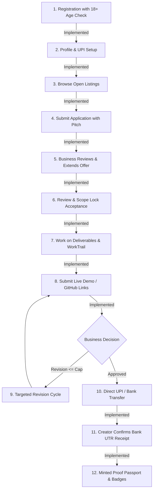
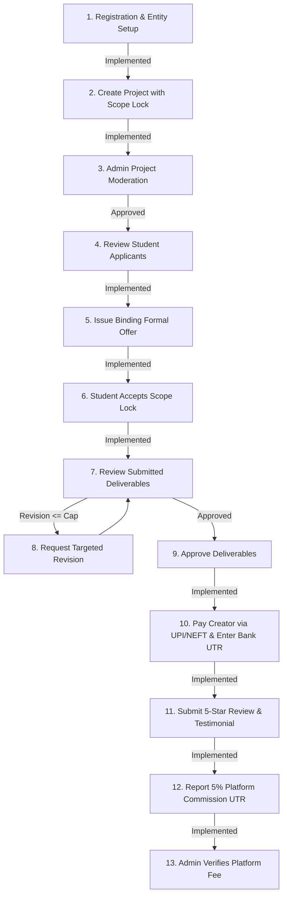
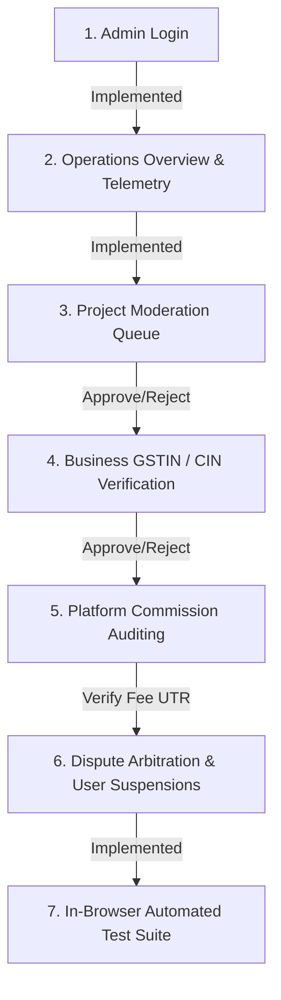

# Proof-to-Pay — Complete User Journey Documentation

This document maps the real user journeys implemented in the codebase for each role: **Student Creator**, **Business Client**, and **Super Admin**. Each step is audited against the actual source code and classified as **Implemented**, **Partially Implemented**, or **Missing**.

---

## 1. Student Creator Journey

### Step-by-Step Technical Audit

| Step | User Action | Code Implementation & Location | Status | Audit Findings |
|---|---|---|---|---|
| **1. Registration & Age Check** | Student inputs name, email, password, and selects age (default 19). | `src/components/pages/AuthModal.tsx` (`handleRegisterStudent`), validated via `StudentRegistrationSchema` in `src/lib/schemas.ts`. | **Implemented** | Rejects applicants under 18 years with error message: *"Marketplace participation requires adult age (18+) to ensure contract validity."* Automatically initializes creator profile. |
| **2. Profile & UPI Setup** | Student edits bio, headline, skills, and enters Indian UPI ID for direct payouts. | `src/components/pages/StudentDashboard.tsx` (`handleSaveProfile`, tab `'profile'`). | **Implemented** | Persists to `MarketplaceStore.updateStudentProfile()`. UPI ID is stored and displayed to hiring businesses upon milestone completion. |
| **3. Browse Projects** | Creator searches projects by keyword, filters by category chips (UI/UX, Web Dev, Python), sorts by budget or deadline. | `src/components/pages/BrowseProjects.tsx` (`BrowseProjects`). | **Implemented** | Filters open projects dynamically. Clicking a project navigates to `project_detail` passing the project ID. |
| **4. Apply to Project** | Student clicks "Apply to Project", enters pitch text (min 20 characters), portfolio links, and turnaround days. | `src/components/pages/ProjectDetail.tsx` (`handleApplySubmit`). | **Implemented** | Stores record in `ptp_applications`. Blocks duplicate applications to the same project with: *"You have already applied for this project."* |
| **5. Receive Formal Offer** | When a business extends an offer, an alert banner appears on Creator Dashboard Overview. | `src/components/pages/StudentDashboard.tsx` (lines 606–645, `offers.filter(o => o.status === 'PENDING')`). | **Implemented** | Displays business name, agreed fixed budget in INR, deadline date, and highlights *"✓ 100% Net Creator Payout: ₹X (₹0 fee deducted from you)"*. |
| **6. Scope Lock Acceptance** | Creator clicks "Review & Lock Scope". Reads deliverables snapshot, deadline, and agrees. | `src/components/pages/StudentDashboard.tsx` (`handleInitiateOfferAcceptance`, `handleConfirmOfferAcceptance`). | **Implemented** | Updates offer status to `'ACCEPTED'`, project status to `'IN_PROGRESS'`, locks deliverable snapshot, and triggers confetti celebration. |
| **7. Work Execution & WorkTrail** | Creator tracks time remaining and logs milestone updates via WorkTrail event timeline. | `src/components/common/WorkTrail.tsx` mounted inside `StudentDashboard.tsx` `'active_projects'` tab. | **Implemented** | Logs timestamped events (OFFER_ACCEPTED, DELIVERABLE_SUBMITTED, PAYMENT_CONFIRMED) creating an auditable audit trail. |
| **8. Submit Deliverables** | Creator submits live Figma/GitHub/Drive URLs and completion notes. | `src/components/pages/StudentDashboard.tsx` (`handleSubmitWork`). Validated via `WorkSubmissionSchema`. | **Implemented** | Validates URL format and notes. Transitions project status to `'SUBMITTED'`. Records submission in `ptp_submissions`. |
| **9. Revisions Handling** | If business requests edits, revision notes appear with remaining revision count. | `src/components/pages/StudentDashboard.tsx` (`proj.status === 'REVISION_REQUESTED'`). | **Implemented** | Shows client feedback. Enforces agreed revision cap (1–5). Student resubmits deliverables. |
| **10. Payment & UTR Receipt** | Business pays student via external UPI/NEFT and posts bank UTR. Creator reviews and confirms receipt. | `src/components/common/PaymentHistory.tsx` (`handleConfirmReceipt`). | **Implemented** | Creator inspects 12-digit UTR reference number and clicks "Confirm Receipt". Transitions payment status to `'RECEIPT_CONFIRMED_BY_CREATOR'`. |
| **11. Minted Proof Passport** | Completed project and verified client endorsement are automatically published to public portfolio. | `src/components/pages/PublicPortfolio.tsx` (`/portfolio/:slug`). | **Implemented** | Displays client rating, verified review quote, live deliverable links, and updates creator badge level. |

---

## 2. Business Client Journey

### Step-by-Step Technical Audit

| Step | User Action | Code Implementation & Location | Status | Audit Findings |
|---|---|---|---|---|
| **1. Business Registration** | Business inputs representative name, company name, corporate email, industry, and city. | `src/components/pages/AuthModal.tsx` (`handleRegisterBusiness`). Validated via `BusinessRegistrationSchema`. | **Implemented** | Creates user with `role: 'BUSINESS'` and initializes `ptp_business_profiles`. Supports adding GSTIN/CIN verification details. |
| **2. Post Project** | Business fills project creation form: Title, summary, description, deliverables list, budget (>=₹1,000), deadline (>=2 days), revision cap (1–5). | `src/components/pages/BusinessDashboard.tsx` (`handleCreateProject`). Validated via `ProjectListingSchema`. | **Implemented** | Submits project with status `'PENDING_REVIEW'`. Sent to Admin moderation queue to ensure zero spec work. |
| **3. Project Moderation** | Admin reviews draft project and approves or rejects with reason notes. | `src/components/pages/AdminDashboard.tsx` (`handleApproveProject`, `handleRejectProject`). | **Implemented** | Upon admin approval, project status becomes `'APPROVED'` and appears publicly on `/browse` and landing carousels. |
| **4. Review Applicants** | Business reviews applicants on "Applications & Offers" tab, inspects student profiles, pitches, and portfolio links. | `src/components/pages/BusinessDashboard.tsx` (`activeTab === 'applications'`). | **Implemented** | Displays applicant details and provides "Shortlist" and "Extend Formal Offer" actions. |
| **5. Issue Formal Offer** | Business specifies agreed budget in INR, deadline date, permitted revisions, and scope summary. | `src/components/pages/BusinessDashboard.tsx` (`handleIssueOffer`). Validated via `ProjectOfferSchema`. | **Implemented** | Creates record in `ptp_offers`. Updates application status to `'OFFER_EXTENDED'`. Alerts student. |
| **6. Review Submissions** | Business inspects student's submitted deliverables (live URLs, Figma preview, GitHub repository, code links). | `src/components/pages/BusinessDashboard.tsx` (`activeTab === 'active_work'`). | **Implemented** | Shows submitted links and notes. Offers two choices: "Approve & Pay" or "Request Revision". |
| **7. Request Revision** | Business requests edits within agreed permitted revisions cap (1 to 5). | `src/components/pages/BusinessDashboard.tsx` (`handleRequestRevision`). Validated via `RevisionRequestSchema`. | **Implemented** | Decrements remaining revision allowance. If student reaches cap (e.g. 3 of 3), button disables to prevent infinite scope creep. |
| **8. Approve & Record Payment** | Business approves final deliverables and records direct payment to student's UPI ID with bank UTR number. | `src/components/pages/BusinessDashboard.tsx` (`handleRecordPayment`). Validated via `RecordPaymentSchema`. | **Implemented** | Requires 12-digit transaction UTR number, payment method (`UPI` or `NEFT_IMPS`), and payment date. Creates record in `ptp_payments`. |
| **9. Leave Review & Testimonial** | Business rates student (1–5 stars) and writes endorsement testimonial. | `src/components/pages/BusinessDashboard.tsx` (`handleSubmitReview`). Validated via `ReviewSubmissionSchema`. | **Implemented** | Saves to `ptp_reviews`. Endorsement is linked to project deliverables and appears on student's public Proof Passport. |
| **10. Pay Platform Fee (5%)** | Business views calculated 5% platform commission (e.g. ₹250 on ₹5,000 project) and submits fee UTR. | `src/components/pages/BusinessDashboard.tsx` (`handleReportCommissionPayment`). | **Implemented** | Business opens modal, reviews Proof-to-Pay bank/UPI credentials, transfers fee, enters UTR reference. Sets status to `'REPORTED_PAID'`. |

---

## 3. Super Admin Operations Journey

### Step-by-Step Technical Audit

| Step | Admin Action | Code Implementation & Location | Status | Audit Findings |
|---|---|---|---|---|
| **1. Admin Login** | Admin logs in via email/password or 1-Click Sandbox Admin login ("Roy"). | `src/components/pages/AuthModal.tsx` (`handleQuickDemo('admin-1')`). | **Implemented** | Validates `role === 'ADMIN'`. Redirects immediately to `admin_dashboard`. |
| **2. Operations Overview** | Inspects platform metrics: total INR volume, active projects, creators count, open disputes. | `src/components/pages/AdminDashboard.tsx` (`activeTab === 'beta_ops'`). | **Implemented** | Real-time aggregation of store counts, beta feedbacks, and abuse flags. |
| **3. Project Moderation** | Admin inspects pending project submissions and verifies they adhere to "Zero Spec Work" rules. | `src/components/pages/AdminDashboard.tsx` (`activeTab === 'projects'`). | **Implemented** | "Approve Listing" publishes project to browse; "Reject" prompts for a structured rejection reason. |
| **4. Business Verification** | Admin reviews business legal entity documents (GSTIN, CIN, PAN, or MSME Udyam). | `src/components/pages/AdminDashboard.tsx` (`activeTab === 'verifications'`). | **Implemented** | "Verify Entity" upgrades business to `VERIFIED` status, granting the verified checkmark badge on project cards. |
| **5. Commission Fee Audit** | Admin inspects reported 5% platform fee payments and marks them verified. | `src/components/pages/AdminDashboard.tsx` (`activeTab === 'monetization'`). | **Implemented** | Calls `marketplaceStore.adminVerifyPlatformCommission()`. Validates admin role RBAC; updates status to `'VERIFIED_COLLECTED'`. |
| **6. Dispute Arbitration** | Admin reviews disputed milestones or payment disagreements and issues binding ruling. | `src/components/pages/AdminDashboard.tsx` (`activeTab === 'disputes'`). | **Implemented** | Resolves dispute with resolution notes, updating dispute record to `RESOLVED`. |
| **7. User Management** | Admin inspects user registry, suspends bad actors, or resets suspension. | `src/components/pages/AdminDashboard.tsx` (`activeTab === 'users'`). | **Implemented** | "Suspend Account" prompts for reason, disables user login, and rejects active applications. |
| **8. Automated Security Tests** | Admin clicks "Run Platform Test Suite" in the header to run live in-browser security & financial math assertions. | `src/components/pages/AdminDashboard.tsx` (`runAutomatedTests`, `activeTab === 'tests'`). | **Implemented** | Runs 6 live in-browser test assertions verifying RBAC guards, paise math, duplicate application blocking, and commission invariances. |

---

## 4. Journey Gaps & Limitations

1. **Email / SMS Notifications are Simulated**:
   - When a business extends an offer or a creator submits work, in-app badges and banners update immediately. However, there is no real-world email (SendGrid/Resend) or SMS (Twilio) service configured to notify users outside the active session.
2. **Dispute Creation Trigger in Student UI**:
   - While the Business Dashboard and Admin Dashboard have dedicated dispute controls, the Student Dashboard does not currently have an explicit "Initiate Scope Dispute" button inside the active workflow tab (students currently raise issues via "Request Support" or "Payment Issue").
3. **Automated Bank Reconciliation**:
   - Bank UTR verification relies on manual human verification by the admin and creator rather than automated Open Banking / Account Aggregator API webhooks.
